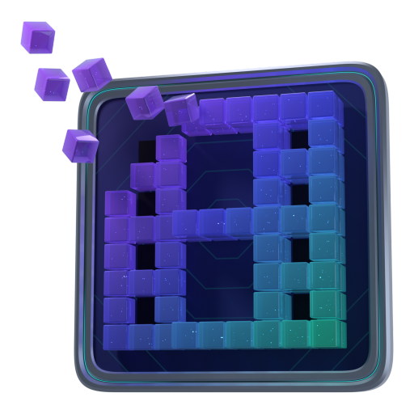

<p align="center">
  
</p>

<h1 align="center">libfilmshell</h1>

<p align="center">The library for parsing Halo Infinite film files.</p>

<p align="center">
  <a href="https://github.com/OpenSpartan/libfilmshell/actions/workflows/ci.yml"></a>
  <a href="LICENSE"></a>
  
</p>

`libfilmshell` is designed to parse out useful data from Halo Infinite film files. I first wrote about
parsing them in [Extracting Match Stats From Halo Infinite Film
Files](https://den.dev/blog/extracting-stats-film-files-halo-infinite/), and this library is me
actually wrapping a lot of the investigations into one, easy-to-consume package.

This is the library that powers [OpenSpartan Films](https://films.openspartan.com).

## Install

```toml
[dependencies]
filmshell = { git = "https://github.com/OpenSpartan/libfilmshell" }
```

## Film Chunks

Halo Infinite records every match for theater replay in **chunks** that are listed through the API.
There are three types that are available, and all are used by `filmshell` to be able to reconstruct
the play-by-play in-game behaviors.

| Type | `ChunkKind`  | Where  | What's in it                                                         |
| ---- | ------------ | ------ | -------------------------------------------------------------------- |
| 1    | `Header`     | First  | Who played, details about the map, the game mode, and the game build |
| 2    | `Replay`     | Middle | The match itself                                                     |
| 3    | `Highlights` | Last   | Summary of kills, deaths, and medals on the theater timeline         |

To be able to reconstruct the match, you will ideally have all the chunks available. You can
download them yourself with the help of a script or a third-party tool - you can use your own
[Spartan token](https://den.dev/blog/halo-api-authentication/) to download those, including for
matches other players participated in.

## Quick start

To extract film data, wrap each chunk in a `Chunk` and pass them all to `Film::from_chunks`:

```rust
use filmshell::{Chunk, ChunkKind, Film};

/// `chunks`: (index, chunk type, bytes) for every chunk of one film.
fn print_match(chunks: &[(u32, u32, Vec<u8>)]) -> Result<(), filmshell::Error> {
    let film = Film::from_chunks(chunks.iter().map(|(index, chunk_type, bytes)| {
        let kind = ChunkKind::from_manifest(*chunk_type).expect("a known chunk type");
        Chunk::new(*index, kind, bytes.as_slice())
    }))?;

    let name = |id| film.player(id).and_then(|p| p.name()).unwrap_or("unknown");
    for player in film.players() {
        println!("{}", name(player.id));
    }
    for (tick, kill) in film.kills() {
        let killer = kill.killer.map_or("the environment", name);
        println!("{tick}: {killer} killed {}", name(kill.victim));
    }
    Ok(())
}
```

Chunks saved as files named `filmChunk{N}` (as downloaded) or `filmChunk{N}_dec` (inflated) need no
manifest: `Chunk::from_file(name, bytes)` takes the index from the file name and the kind from the
bytes. The [`examples` folder](examples) has a few small sample programs that can read a film saved
as a folder of chunk files and then interpret their contents:

```sh
cargo run --release --example players -- path/to/film            # the match, its players and the score
cargo run --release --example kills -- path/to/film              # every kill with its weapon
cargo run --release --example timeline -- path/to/film 3         # one player's match, event by event
cargo run --release --example playback -- path/to/film 90        # everyone's state 90 seconds in
cargo run --release --example trails -- path/to/film > map.svg   # every path and kill, drawn as a map
cargo run --release --example raw -- path/to/film                # the packets and events underneath
```

>[!NOTE]
>Any captured positions are in world units - just as the game uses them. They should typically
>convert exactly on every level the library is familiar with. For any other level, give the level's
>bounds or the map's spawn points with `Hints` and `Film::from_chunks_with`, or read the unconverted
>coordinates from `Sample::raw`. A `Sample` records where a player was at a given tick, along with
>their aim, speed, health, and shield.

If you would like to read the raw contents of the film, `Film::raw()` exposes what the actual
underlying data model is built from: inflated chunks, packets, frames, each frame's events and
entity updates, the seek snapshots and a bit reader. It is mostly useful for working on the format
itself - most applications you will build with `libfilmshell` won't need it.

## License

MIT. See [LICENSE](LICENSE).

## Maintainers

- [Den Delimarsky](https://den.dev) (with 💖 for Halo and the Halo community)